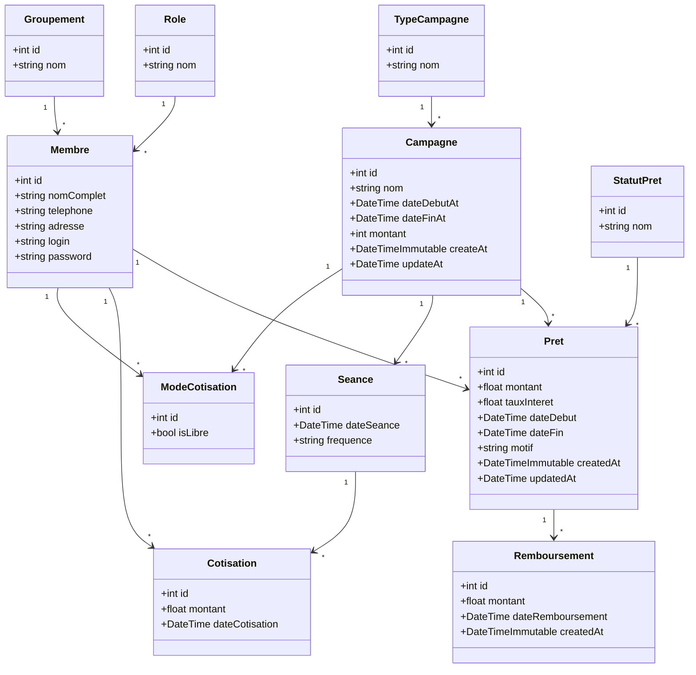

# Modele de classes - avecLesFemmes

Application de gestion de calabasses participatives (epargne, tontine et prets).

## Diagramme

## Regles metier

- `ModeCotisation.isLibre` vaut `false` lorsque le membre doit cotiser le montant fixe de la campagne, et `true` lorsqu'il cotise librement.
- La relation `Membre` - `Campagne` est une many-to-many avec attribut : elle est donc representee par `ModeCotisation`.
- Un `Pret` est porte par un `Membre` et peut etre rattache a une `Campagne`.
- Un `Pret` possede un `StatutPret` (en attente, approuve, en cours, rembourse, rejete).
- Les `Remboursement` sont rattaches a un `Pret` et permettent de suivre le capital restant du.

## Captures de la modelisation

Deposer dans ce dossier les photos du tableau et les captures du diagramme de classes
(`modele-classes.png` ou `modele-classes.jpg`).
